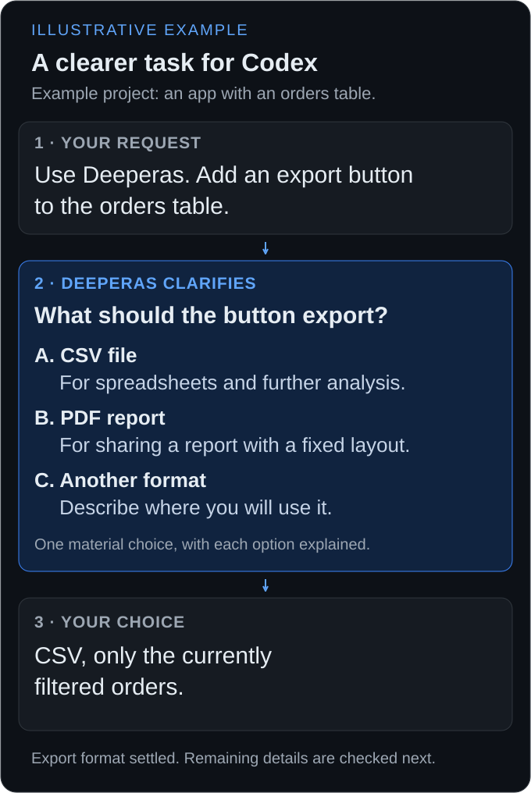

<p align="center">
  
</p>

# Deeperas

**Make your AI clarify what matters before it acts.**

[](INSTALL.md#codex)
[](INSTALL.md#cursor)
[](https://github.com/IIVIIask/deeperas/releases/latest)
[](LICENSE)
[](https://github.com/IIVIIask/deeperas/actions/workflows/package-checks.yml)

Deeperas helps Codex turn vague requests into clear tasks. It guides the agent to clarify decisions that matter, inspect available project context, and follow your agreed direction before changing files or starting implementation. The same skill also works in Cursor.

Describe what you want to build, change, or investigate. If an important choice is still open, Deeperas guides the agent to ask one focused question with explained options. Clear tasks and explicitly delegated choices can proceed directly.

**Version** `0.2.48+20261014r42` (skill revision R42) · [Changelog](CHANGELOG.md) · [Update an existing installation](INSTALL.md#updating-an-existing-installation)

[Install](#installation) · [Example](#example) · [How it works](#how-it-works) · [Power users](#for-power-users) · [FAQ](#faq) · [MIT license](LICENSE)

---

## Installation

Both hosts receive the same skill. Use a recent host version with plugin support. See [what was tested](INSTALL.md#tested-with).

### Codex

Requires the [Codex CLI](https://learn.chatgpt.com/docs/cli). Run the commands below in your terminal.

```sh
codex plugin marketplace add IIVIIask/deeperas --ref main
codex plugin add deeperas@deeperas
```

Start a new conversation, then ask:

```text
Use Deeperas to help me plan my project.
Ask me about the choices that matter before you start building.
```

### Cursor

Open **Customize → + Add → From GitHub Repository**, enter the URL below, then add **Deeperas**:

```text
https://github.com/IIVIIask/deeperas
```

Start a new Agent conversation and type `/deeperas`, or ask the assistant to use Deeperas.

Prefer to copy the skill into a project? See the [installation guide](INSTALL.md), which also covers updating.

### Calling Deeperas

Ask for Deeperas by name, or select it explicitly: `$deeperas` in Codex CLI, `@Deeperas` in the Codex app, or `/deeperas` in Cursor.

Your app controls when the skill is loaded. See [Cursor message and session use](INSTALL.md#using-deeperas-in-cursor) and [activation troubleshooting](INSTALL.md#troubleshooting).

## Example

Example project: an app with an orders table, with Deeperas loaded in Codex.

**Your request**

> Use Deeperas. Add an export button to the orders table.

**Deeperas clarifies**

> **What should the button export?**
>
> **A. CSV file**: For spreadsheets and further analysis.
>
> **B. PDF report**: For sharing a report with a fixed layout.
>
> **C. Another format**: Describe where you will use it.

**Your choice**

> CSV, only the currently filtered orders.

The export format is settled. If another detail matters for implementation, Deeperas guides the agent to clarify it next.

*Illustrative example, not a captured Codex conversation.*

<details>
<summary><strong>View the illustrated example</strong></summary>



</details>

## When to use it

In Codex and Cursor, use Deeperas when an unresolved choice could change the work:

- **Plan a feature**: Clarify the goal, intended users, and scope before planning implementation.

- **Investigate a bug**: Inspect available code and error evidence, and clarify expected behavior when it is unclear.

- **Refactor code**: Agree on the scope and behavior to preserve before changing the structure.

- **Choose an implementation approach**: Investigate the project constraints and clarify your priorities before recommending an approach.

Answer in your own words, choose an option, or delegate a decision. Clear tasks can proceed directly. The same workflow also applies to writing, research, and planning outside software projects.

## How it works

**1. Clarify.** Ask one focused question about the most consequential unresolved choice, and explain what each option means. Important preferences are never decided silently.

**2. Verify.** Investigate discoverable facts with the available files, tools, and sources. Ask you only about your intent, not about things the assistant can look up itself.

**3. Deliver.** Answer or act once the choices the work depends on are settled. Check the result before claiming completion, and say what the evidence does not establish.

In a project, decisions are staged. The goal and critical constraints come first; later decisions are asked just before the work needs them. Independent work can continue while a question is open, as long as the answer cannot change that work's inputs or method.

Answering one question settles only that gap. If another missing condition changes which method is suitable, the assistant clarifies it before recommending the method or giving steps.

## For power users

**Start using it**

> “Use Deeperas to help me plan this change.”

**Delegate a particular choice**

> “Choose the visual style for me, but ask about the user flow.”

**End the questions for this request**

> “Answer now with what you can support.”

**Stop using the workflow**

> “Stop using Deeperas for this task.”

“Answer now” ends the questions. It does not fill in missing targets, waive verification, or grant permission for external actions. The assistant returns what it can support and explains the remaining limits.

The skill is one [core file](plugins/deeperas/skills/deeperas/SKILL.md) plus five topic references in `references/`. The plugin installs all six; when copying manually, copy the whole skill folder.

The [power-user guide](docs/POWER-USERS.md) explains activation, the clarification gate, project decision records, host-specific controls, the [reference files](docs/POWER-USERS.md#the-skill-bundle), and verification boundaries.

## FAQ

<details>
<summary><strong>Can I copy just SKILL.md?</strong></summary>

No. The core needs the matching `references/` folder. Plugin installation includes it automatically. For a manual installation, copy the entire `deeperas` skill folder as described in the [installation guide](INSTALL.md).

</details>

<details>
<summary><strong>Will it interview me about everything?</strong></summary>

No. It asks only about meaningful uncertainty and about alternatives you named but did not choose. A clear request or an explicitly delegated choice proceeds directly. For a vague creation idea, it first checks whether you want to start planning at all.

</details>

<details>
<summary><strong>Do I need to know how to code?</strong></summary>

No. After installation, describe your goal in normal language. Answer in your own words or pick an option. The workflow is not limited to software projects.

</details>

<details>
<summary><strong>Does it need an API key or another service?</strong></summary>

No. Deeperas is instructions and plugin manifests only: no server, no MCP server, no hooks, no telemetry. Your AI host still runs the model, conversation, files, and tools under its own settings and permissions.

</details>

<details>
<summary><strong>Does it update automatically?</strong></summary>

Supported team/workspace marketplaces can sync from GitHub automatically. Personal installations may need a marketplace refresh or a manual folder replacement. See [updates and automatic sync](INSTALL.md#updating-an-existing-installation) for your host.

</details>

<details>
<summary><strong>Does it guarantee correct answers?</strong></summary>

No. Verification depends on the tools and evidence your host makes available. Model behavior varies, and the skill cannot override platform rules.

</details>

## Feedback and contributions

[Report a problem](https://github.com/IIVIIask/deeperas/issues/new?template=bug_report.yml) using the **Bug report** form: include your application and versions, a small example, and the expected versus actual result. Remove private information before posting.

Changes to the instructions should come with an example that makes the intended behavior easy to judge. For the local checks, see [development](docs/POWER-USERS.md#development).

## License

[MIT](LICENSE) · Copyright © 2026 IIVIIask.
