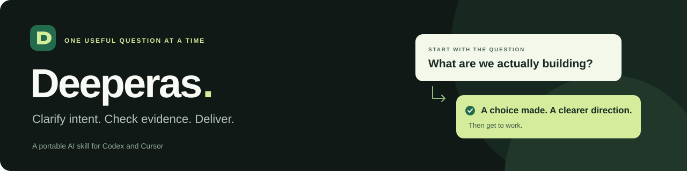

# Deeperas

**Ask what matters. Check the evidence. Then do the work.**

A skill that guides your AI assistant to understand what you want before it commits to an answer or starts building.

You describe the idea. Deeperas helps the assistant uncover the choices that actually change the result, one focused question at a time. It explains the options, investigates facts with the tools it has, and proceeds when the direction is clear.

Already know exactly what you want? Say it. Want the assistant to choose for you? Delegate that decision. Clear tasks should get done.

[Install](#installation) · [See an example](#before-and-after) · [How it works](#how-it-works) · [Power users](#for-power-users) · [MIT license](LICENSE)

---

## Installation

### Codex

Run these two commands:

```sh
codex plugin marketplace add IIVIIask/deeperas
codex plugin add deeperas@deeperas
```

Start a new conversation, then ask:

```text
Use Deeperas to help me plan my project.
Ask me about the choices that matter before you start building.
```

### Cursor

Open **Customize → From GitHub Repository**, add the URL below, and install **Deeperas**:

```text
https://github.com/IIVIIask/deeperas
```

Start a new Agent conversation and invoke `/deeperas`, or ask the assistant to use Deeperas.

Prefer to copy the skill into a project? See the [step-by-step installation guide](INSTALL.md), including a local Cursor option.

**Compatibility:** Codex installation from this repository has been tested. The Cursor package follows Cursor's documented formats; an in-app installation test is still pending. Use a recent host version with plugin or Agent Skills support.

## Before and after

The prompt sounds simple:

> Help me plan a page for my plugin.

But “a page” can mean different things. A rushed assistant may pick one and start writing. Deeperas is designed to surface that choice first:

> **Where should people read it?**
>
> **A. Inside the GitHub repository** — a README with installation, examples, and documentation.
>
> **B. On a standalone website** — a separate presentation page for visitors.
>
> **C. Both** — a website and repository documentation, with a shared explanation.

Choose **A**, and the assistant has a concrete direction: a repository presentation. It can then clarify the audience and other decisions that matter before producing the work.

*Illustrative example, not a benchmark or a captured model response. More questions may follow when important choices remain.*

## When to use it

| You want to… | Deeperas guides the assistant to… |
| --- | --- |
| Plan a project or a feature | Establish the goal, audience, constraints, and decisions the next step depends on. |
| Compare approaches | Separate your preferences from facts it can investigate. |
| Research a question | Check available evidence and make remaining gaps clear. |
| Work through a complex request | Keep settled choices, track dependencies, and revisit only what new evidence changes. |

It works through ordinary conversation. You can choose an option, explain your own answer, or delegate a decision. It is useful beyond coding: writing, research, planning, and everyday decisions all involve unclear intent.

## How it works

**1. Clarify.** Ask one focused question about the most consequential unresolved choice. Explain what each option means. Avoid deciding important preferences silently.

**2. Verify.** Use available files, tools, and sources to investigate discoverable facts. Ask you about your intent, rather than things the assistant can look up itself.

**3. Deliver.** Answer or act when the choices that work depends on are settled. Check results before claiming completion, and identify what the evidence does not establish.

For projects, decisions can be staged. The assistant may continue independent work while a question is open, provided the answer cannot change that work's inputs or method.

## For power users

One portable skill. Readable instructions. Your existing AI host does the work.

| What you want | What to say |
| --- | --- |
| Start using it | “Use Deeperas to help me plan this change.” |
| Delegate a particular choice | “Choose the visual style for me, but ask about the user flow.” |
| End the questions for this request | “Answer now with what you can support.” |
| Stop using the workflow | “Stop using Deeperas for this task.” |

“Answer now” does not fill in missing targets or grant permission for external actions. The assistant should return supported results and explain any remaining limits.

The [power-user guide](docs/POWER-USERS.md) explains the clarification gate, project decision records, host-specific controls, package structure, and verification boundaries. You can also [read the complete skill](plugins/deeperas/skills/deeperas/SKILL.md).

## FAQ

<details>
<summary><strong>Will it interview me about everything?</strong></summary>

The instructions target meaningful uncertainty and explicit, unselected alternatives. A clear request or an explicitly delegated choice should proceed directly. For a vague creation idea, it first checks whether you want to begin planning.

</details>

<details>
<summary><strong>Do I need to know how to code?</strong></summary>

No. After installation, describe your goal in normal language. Answer in your own words or select an option. The workflow is not limited to software projects.

</details>

<details>
<summary><strong>Does it need an API key or another service?</strong></summary>

Deeperas itself does not. It contains instructions and plugin manifests, with no Deeperas server, custom MCP server, hooks, or telemetry code. Your AI platform still handles the model, conversation, files, and tools under its own settings and permissions.

</details>

<details>
<summary><strong>Does it guarantee correct answers?</strong></summary>

No. Verification depends on your host's available tools and evidence. Model behavior can vary; the skill guides instruction following and does not override platform rules.

</details>

## Feedback and contributions

[Open an issue](https://github.com/IIVIIask/deeperas/issues) with your host and version, a small example prompt, and what you expected versus what happened. Remove private information before posting.

Changes to the instructions should include an example that makes the intended behavior easy to judge. For local checks, see [development](docs/POWER-USERS.md#development).

## License

[MIT](LICENSE) · Copyright © 2026 IIVIIask.
